# 1. Обзор продукта

## Назначение

«Emmet · Тетрадь» — тренажёр для урока вёрстки в компьютерном классе. Студенты решают
практические работы в браузере, преподаватель видит прогресс группы в реальном времени.

Занятие состоит из двух частей:

1. **Emmet.** Каждый студент получает **личный случайный набор из 10 работ** из банка в 30.
   Слева показан образец: HTML, который должен получиться, и его вид в браузере. Справа —
   редактор «в клетку». Нужно подобрать Emmet-сокращение, развернуть его клавишей `Tab` и получить
   проверку. HTML, набранный руками, не засчитывается.
2. **Контейнеры.** Сначала страница теории «id, class и контейнеры», затем **10 заданий, одинаковых
   для всех**. Здесь HTML можно писать руками. Код ответа не показывается: слева сверху видно, как
   выглядит код студента, снизу — как должно выглядеть. Переключатель «Браузер / Схема» рисует обе
   страницы либо как чистый HTML, либо как схему коробок с метками тегов, id и class.

## Роли

| Роль | Вход | Что может |
| --- | --- | --- |
| Студент | Личный ключ `stWeb-###` на `/` | Решать свои работы, читать теорию, видеть свой прогресс |
| Преподаватель | Ключ `ADM-XXXX-XXXX` на `/admin` (или на `/`, с перенаправлением) | Видеть сводку и матрицу, код каждой попытки, выгружать CSV, печатать карточки с ключами, сбрасывать статистику, выдавать новый набор, завершать и открывать занятие |

## Ход занятия

```mermaid
flowchart LR
  A[Преподаватель: roster.txt → npm run keys] --> B[npm run build && npm start]
  B --> C[Раздача карточек с ключами]
  C --> D[Студенты входят по ID]
  D --> E[10 работ Emmet]
  E --> F[Теория: id, class, контейнеры]
  F --> G[10 заданий на контейнеры]
  G --> H[Преподаватель: «Завершить занятие»]
  H --> I[CSV / stats.json — результаты]
```

## Экраны

### Студент (`index.html`)

| Экран | Когда | Содержимое |
| --- | --- | --- |
| Вход | Нет сохранённого ключа | Карточка на фоне в клетку: бренд, «Вход в тетрадь», поле «Ваш ID», кнопка «Войти» |
| Тетрадь: задание Emmet | Шаги 1–10 | Сверху: бренд, навигация (счётчик «N / 20», стрелки, точки), имя и кнопка выхода. Ниже две панели 50/50: **Образец** (HTML с подсветкой и вид в браузере) и **Практическая работа** (условие, уровень, редактор, сворачиваемый «Результат», обратная связь, «Проверить») |
| Теория | Перед первым заданием на контейнеры | Одна широкая панель со статьёй и кнопкой «К заданиям» |
| Тетрадь: контейнеры | Шаги 11–20 | Образец: «Ваш код» сверху и «Как должно выглядеть» снизу, переключатель «Браузер / Схема». Редактор: HTML руками или через Emmet |
| «Занятие окончено» | Преподаватель завершил занятие | Карточка с галочкой и текстом «Спасибо за работу!»; страница сама обновится, когда занятие откроют снова |

### Преподаватель (`admin.html`)

- **Шапка:** бренд «панель преподавателя», время обновления, кнопки «Завершить/Открыть занятие», «Обновить», «Ключи», «Excel», «Выйти».
- **Баннер** (если занятие завершено): красная плашка со временем завершения.
- **Сводка, 3 карточки:** «В тетради» (онлайн / всего), «Решено» (% и количество), «Нарушения» (HTML вручную + вставки + уходы, с расшифровкой).
- **Матрица «студент × работа»:** вкладки разделов Emmet / Контейнеры, поиск, сортировка, легенда, итоги по каждой работе внизу.
- **Карточка студента** (диалог): статистика по каждой работе, код решения, «Новый набор», «Сбросить статистику».
- **Ключи** (диалог): таблица ФИО → ID с копированием, печать карточек по две в ряд.

## Ключевые свойства

- Проверка структурная (по дереву DOM), а не текстовая. Сообщения конкретные: «Внутри `<ul>` должно быть 3 × `<li>`, сейчас 2».
- Прогресс хранится на сервере и восстанавливается с любого компьютера.
- Многоуровневая защита от списывания (см. [06-validation-anticheat.md](06-validation-anticheat.md)).
- Предпросмотр кода студента — в изолированном `iframe sandbox=""` с CSP.
- Интерфейс помещается в окно от 1280×720 без прокрутки. Уже 960 px панели встают друг под друга.
- Доступность: управление с клавиатуры, живые регионы, `prefers-reduced-motion`.
- Только светлая тема (`color-scheme: light`).
