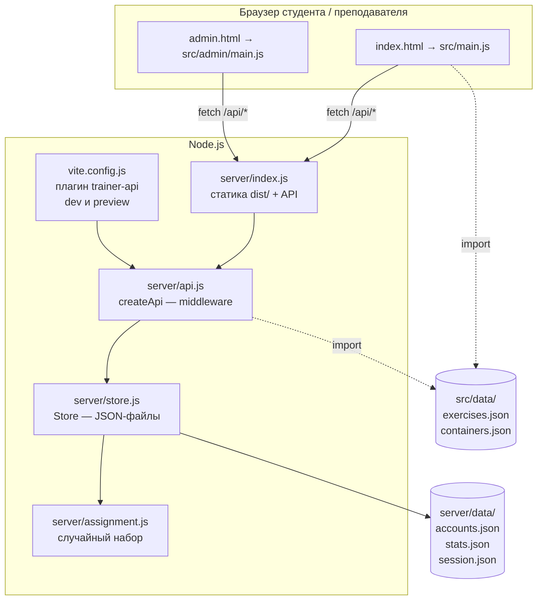
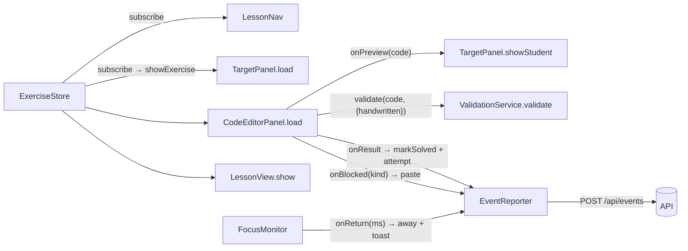
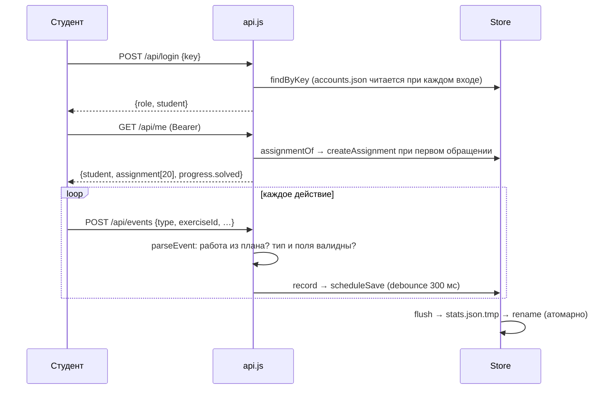
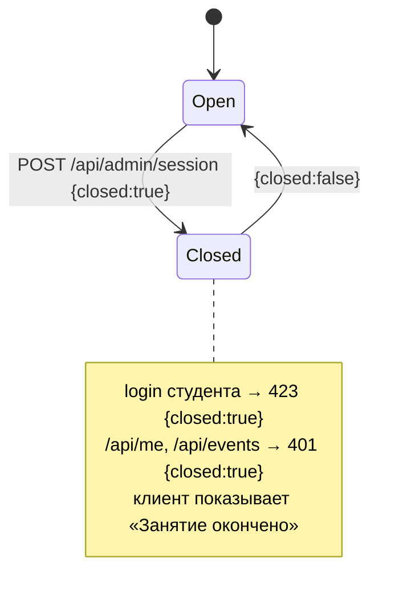

# 2. Архитектура

## Общая схема



- **Одна кодовая база API** (`createApi()`) работает в двух местах: в продакшен-сервере `server/index.js`
  и в dev- и preview-сервере Vite через плагин `trainer-api`.
- **Данные заданий общие** для клиента и сервера: оба импортируют `src/data/*.json`. Клиент вычисляет эталон
  и проверяет ответ. Сервер знает только id и сложность (для наборов и проверки, что работа «своя»).
- **Правильность решения определяет клиент.** Сервер сохраняет присланный статус и не перепроверяет его.

> ⚠️ Нельзя одновременно запускать `npm run dev` и `npm start` на одних данных. Каждый процесс держит
> свою копию статистики в памяти и перезаписывает `stats.json`. Кроме того, dev-плагин Vite не
> сбрасывает статистику на диск при выходе (в отличие от `server/index.js`, который ловит SIGINT/SIGTERM).

## Слои клиента

```text
src/
├── main.js                  точка входа студента: boot → вход → App → связка компонентов
├── admin/main.js            точка входа преподавателя: AdminPanel
├── admin/stats.js           чистые функции расчётов для панели (тестируются отдельно)
├── components/              UI-компоненты: класс + root-элемент, разметка через innerHTML
│   ├── LoginScreen.js       форма входа (общая для обеих страниц)
│   ├── LessonNav.js         счётчик, стрелки, точки шагов
│   ├── TargetPanel.js       образец: режим «код + результат» или «ваш код / как должно»
│   ├── LessonView.js        статья-теория + константа CONTAINERS_LESSON
│   ├── CodeEditorPanel.js   CodeMirror, Tab/Emmet, блокировка вставки, проверка
│   ├── PreviewFrame.js      sandbox-iframe, sanitize(), варианты plain/clean/boxes
│   ├── ExerciseInstructions.js  условие и уровень
│   ├── FeedbackMessage.js   плашка результата (живой регион)
│   └── icons.js             SVG-иконки строками
├── services/                логика без DOM-разметки
│   ├── ExerciseStore.js     план, текущий шаг, решённые; простой pub/sub
│   ├── ValidationService.js проверка ответа → { status, title, message, extra }
│   ├── EmmetService.js      expand/extract поверх пакета emmet, ошибки по-русски
│   ├── HandwrittenTracker.js расширение CodeMirror: что набрано руками
│   ├── FocusMonitor.js      уходы со страницы
│   ├── Api.js               fetch-обёртка, SavedKey, EventReporter (очередь событий)
│   └── highlight.js         escapeHtml и подсветка HTML для образца
├── data/                    exercises.json, containers.json
└── styles/                  main.css (токены и все компоненты), boxes.css (схема коробок)
```

**Принципы кода:**

- Без фреймворков. Компонент — это класс, которому передают корневой элемент. Он рендерит разметку шаблонной строкой и навешивает обработчики.
- Пользовательский текст всегда проходит через `escapeHtml`.
- Состояние хранится в `ExerciseStore`. Компоненты подписываются (`subscribe`) и перерисовываются.
- Комментарии и все тексты интерфейса на русском.

## Сборка связей в `App` (src/main.js)



### План студента

1. Сервер отдаёт `assignment`: 10 id из банка Emmet (личные) и 10 id заданий на контейнеры (общие).
2. `buildPlan()` превращает id в объекты заданий и вставляет перед первым заданием на контейнеры шаг-теорию `CONTAINERS_LESSON` (`kind: 'lesson'`).
3. `ExerciseStore` вычисляет `expectedHtml` развёртыванием `emmetExpression` (у теории его нет).
4. `resumeIndex()` — первая нерешённая работа. Если перед ней теория, а раздел ещё не начат, открывается теория.
5. Нумерация сквозная только по работам: `taskNumber()` → «11 / 20». Для теории счётчик показывает «Теория».

### Переключение шага (`showExercise`)

- **Теория:** панели образца и редактора скрыты, видна `#lesson`. Теория сразу отмечается решённой (только на клиенте). Событие `open` не отправляется, уходы со страницы не пишутся.
- **Задание:** `target.load(ex)`, `editor.load(ex)`, затем событие `open`.
- **Режим редактора** зависит от `exercise.mode`: `emmet` или `html`. От режима зависят плейсхолдер, подсказка по клавишам, поведение `Tab`, idle-сообщение и видимость своего предпросмотра.
- **Режим образца** зависит от `exercise.section`: `emmet` — HTML с подсветкой и превью; `containers` — два превью и переключатель вида.

## Предпросмотр (PreviewFrame)

- `<iframe sandbox="" referrerpolicy="no-referrer">` с `srcdoc`. Внутри CSP `default-src 'none'; style-src 'unsafe-inline'; img-src data:`.
- `sanitize(html)` удаляет `script, iframe, frame, object, embed, link, meta, base, style, template`, атрибуты `on*` и значения `javascript:`. Затем расставляет подписи:
  - `data-t` — имя тега (для пустых элементов в варианте plain);
  - `data-label` — `tag#id.class` (подпись на схеме);
  - `data-kind` — `id | class | tag` для не-контейнеров (цвет метки).
  - Опция `stripNames: true` убирает id и class, чтобы пример теории, вставленный прямо в страницу, не подхватил стили сайта (`.btn`, `.card`).
- **Варианты:** `plain` (пунктир вокруг тегов, тёплый фон) — образец Emmet и «Результат» студента; `clean` (стили браузера по умолчанию, белый фон) — «Браузер»; `boxes` (`boxes.css` через `?raw`) — «Схема».
- **Обход бага Chrome:** sandbox-iframe, загруженный внутри `display:none`, не отрисовывается. `ResizeObserver` замечает момент, когда iframe стал видимым, и вставляет его в DOM заново, после чего он перерисовывается.

## Сервер



- `server/index.js` — `http.createServer`: сначала API-middleware, потом статика из `dist/` с короткими адресами `/` и `/admin`. Файлы из `assets/` (с хешем в имени) кешируются навсегда, остальные отдаются с `no-cache`. Защита от выхода за пределы `dist/`. При запуске печатаются адреса в локальной сети. На SIGINT/SIGTERM вызывается `store.flush()`.
- `api.js` — таблица маршрутов `"METHOD /path" → handler`, класс `HttpError(status, message, extra)`, ответы JSON с `Cache-Control: no-store`.
- `store.js` — `accounts` (getter, файл читается каждый раз: новые ключи работают без перезапуска), `stats` в памяти с отложенной записью, `session` пишется сразу.
- `assignment.js` — `createAssignment` (тасование Фишера — Йейтса на `crypto.randomInt`, результат в порядке банка) и `isValidAssignment` (набор пересоздаётся, если банк изменился).

## Жизненный цикл занятия (сессия)



- Состояние хранится в `server/data/session.json` (`{closedAt}`) и переживает перезапуск сервера.
- Открытая тетрадь раз в 15 с опрашивает `GET /api/session` и перезагружается, когда занятие закрыто. Экран «Занятие окончено» так же перезагружается, когда занятие открывают снова. Ключ при этом не стирается.
- Если `EventReporter` получает `{closed:true}`, страница перезагружается сразу.

## Надёжность

- **Офлайн-очередь:** `EventReporter` отправляет события строго по порядку. При сетевой ошибке повторяет через 5 с, индикатор у имени становится красным. На 4xx событие отбрасывается, на 401 — выход из аккаунта.
- **Атомарная запись** JSON через временный файл и `rename`.
- **Старые записи статистики** при записи дополняются новыми полями (`{...emptyExercise(), ...old}`), поэтому формат можно расширять.
- **localStorage недоступен** (приватный режим): `SavedKey` хранит ключ в памяти до перезагрузки страницы.
